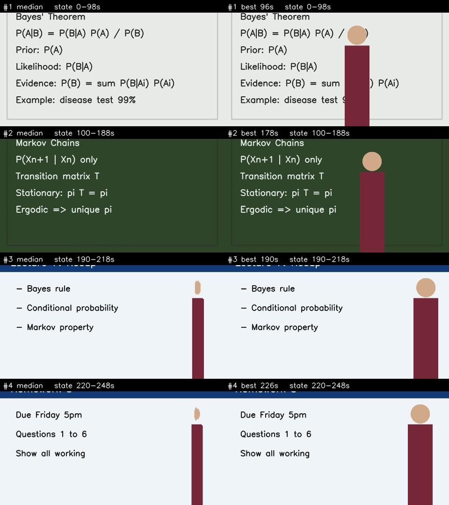
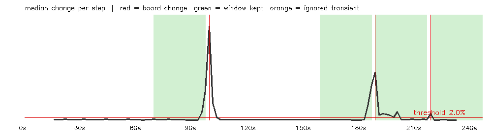

# BoardCapture

Turns a lecture recording into clean images of every board and slide, with the professor removed, and optionally into OCR text and study notes. Everything runs locally, with no paid API.



## How it works
1. **Sample** one frame every 2 seconds.
2. **Remove the professor** with a rolling, person-masked median over 15 frames (30 s). The professor moves and the board doesn't, so the median keeps the board.
3. **Detect board changes** by measuring how much the median changes between steps. Spikes that revert (the professor paused) are ignored, and spikes where most of the old writing survives count as additions, not new boards.
4. **Capture** the last clean window before each change, which is the fullest view of that board, and save both the cleaned median and the least-occluded real frame.
5. *(Optional)* **OCR** with Tesseract, then **notes** with local models via Ollama.



## Quick start
```bash
conda env create -f environment.yml
conda activate boardcapture

# make a synthetic test lecture (whiteboard, chalkboard, two slides)
python tests/make_mixed_lecture.py

# capture boards only (fast, free)
python bm_main.py tests/mixed_lecture.mp4 --frames-only

# add OCR text and confidence
python bm_main.py tests/mixed_lecture.mp4 --ocr
```
Results go to `out/<video name>/`: `boards/`, `contact_sheet.jpg`, `change_plot.png`, `report.json`, `ocr.json`.

**Notes mode** (`--notes`) needs [Ollama](https://ollama.com) running with `ollama pull qwen2.5vl:7b` and `ollama pull llama3.1:8b`.

## Results on the test lecture
The synthetic 250 s lecture has 4 ground-truth boards. BoardCapture found all 4 at the correct change points (~100 s, ~190 s, ~220 s, end), with Tesseract confidence of 87–95.

## Known limitations
- A presenter who stands still for the whole window (e.g. at a podium during slides) is not removed, because the median sees them as part of the board.

## Design evolution
*(Coming soon: how this grew out of [smartCapture](https://github.com/rRohan-neu/smartCapture) and why each design decision changed.)*
